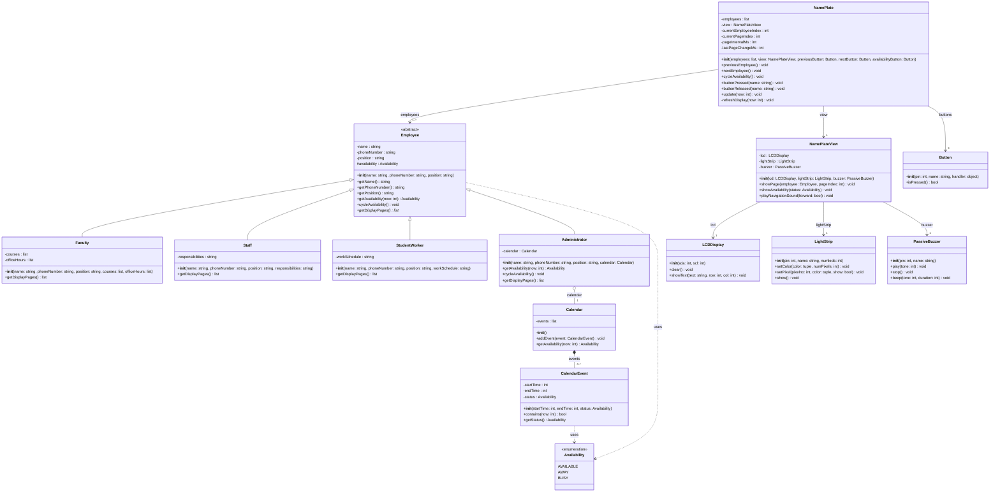

# Office Nameplate System - UML Architecture Specification (Lab 2)

## 1. Overview & Architecture

The system implements a Raspberry Pi Pico-powered dynamic office nameplate adhering to the **Model-View-Controller (MVC)** architectural pattern:

- **Model Layer (`Employee` hierarchy & `Calendar`)**: Domain logic encapsulating employee details, distinct roles, schedule/calendar tracking, and availability status.
- **View Layer (`NamePlateView`)**: Encapsulates all hardware-specific rendering and feedback (LCD text display, NeoPixel LED status, and buzzer sound effects).
- **Controller Layer (`NamePlate`)**: Manages navigation state, processes hardware button events, handles automatic multi-page rotation, and coordinates the View with the Model.

---

## 2. Updated Class Diagram

---

## 3. Requirement Traceability Matrix

| Requirement | Design Element & Implementation |
| :--- | :--- |
| **Different Employee Types with Inheritance** | `Employee` abstract base class extended by `Faculty`, `Staff`, `StudentWorker`, and `Administrator`. |
| **Polymorphic Display Information** | `getDisplayPages()` is defined on `Employee` and implemented distinctly by each subtype to format their unique information (e.g., courses & office hours for Faculty; responsibilities for Staff; work schedule for Student Workers; calendar status for Administrators). |
| **Common Attributes** | `name`, `phoneNumber`, `position` stored on base `Employee` with clean getters. |
| **Automatic Calendar for Administrators** | `Administrator` holds a `Calendar` instance and overrides `getAvailability(now: int)`. `cycleAvailability()` is overridden as a no-op or alert because administrator availability is automated. |
| **Manual Availability Cycling for Everyone Else** | Base `Employee.cycleAvailability()` dynamically cycles through `AVAILABLE` $\rightarrow$ `AWAY` $\rightarrow$ `BUSY` upon button press. |
| **Next & Previous Navigation** | `NamePlate.previousEmployee()` and `NamePlate.nextEmployee()` cycle through the employee roster. |
| **Audio Feedback** | `NamePlateView.playNavigationSound(forward: bool)` plays distinct tones on the `PassiveBuzzer` when moving forward or backward. |
| **Visual Availability Indication** | `NamePlateView.showAvailability(status)` updates the `LightStrip` (Green for Available, Yellow/Amber for Away, Red for Busy). |
| **Controller & View Separation** | Controller (`NamePlate`) coordinates user inputs, state, and auto-page rotation; View (`NamePlateView`) handles all hardware operations. |

---

## 4. Key Improvements Applied Over the Initial Draft

1. **Pruned Hardware Clutter**: Removed the unneeded base classes `Display`, `Buzzer`, and `Light`. Retained only the concrete classes (`LCDDisplay`, `LightStrip`, `PassiveBuzzer`, `Button`) displaying just the public methods invoked by the application.
2. **Standardized UML Generalizations**: All inheritance arrows point cleanly toward their superclasses with standard generalization notation.
3. **Corrected Method Signatures & Types**:
   - Stripped accidental parameter duplicates and typos (`nextEmployee` and `cycleAvailability` take zero parameters; `getPhoneNumber` and `getPosition` have no `now` parameter).
   - Specified precise return types (`string`, `Availability`, `list`, `void`) across all operations.
4. **Clean Encapsulation**: Marked all instance attributes private (`-`) or protected (`#`), with public (`+`) getters.
