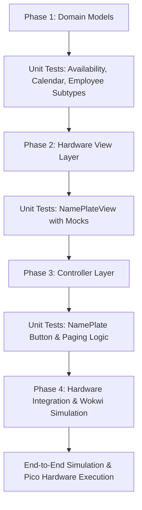

# Mini Lab 2: Office Nameplate System - Implementation Plan

**Course:** Systems Analysis  
**Project:** Raspberry Pi Pico Dynamic Office Nameplate (Mini Lab 2)  
**Author:** Daniel Fisac (`fisac25`)  
**Target Hardware:** Raspberry Pi Pico (RP2040) / Wokwi Simulator (MicroPython v1.28.0)  

---

## 1. System Overview & Architecture

The system implements an interactive, multi-role office nameplate using the **Model-View-Controller (MVC)** architectural design pattern:

```mermaid
graph TD
    subgraph Controller
        NP[NamePlate Controller]
    end

    subgraph Model
        Emp[Employee Base Class]
        Fac[Faculty]
        Stf[Staff]
        SW[StudentWorker]
        Adm[Administrator]
        Cal[Calendar]
        Evt[CalendarEvent]
        Avail[Availability Enum]

        Emp <|-- Fac
        Emp <|-- Stf
        Emp <|-- SW
        Emp <|-- Adm
        Adm --> Cal
        Cal *-- Evt
        Emp ..> Avail
        Evt ..> Avail
    end

    subgraph View
        NPV[NamePlateView]
        LCD[16x2 LCD Display]
        LS[NeoPixel LightStrip Ring]
        BZ[Passive Buzzer]

        NPV --> LCD
        NPV --> LS
        NPV --> BZ
    end

    subgraph Hardware_Inputs
        BP[Previous Button - GP10]
        BN[Next Button - GP11]
        BA[Availability Button - GP12]
    end

    BP -->|IRQ Press| NP
    BN -->|IRQ Press| NP
    BA -->|IRQ Press| NP
    NP -->|Coordinates| NPV
    NP -->|Queries / Cycles| Emp
```

- **Model Layer:** Encapsulates domain logic for different employee roles (`Faculty`, `Staff`, `StudentWorker`, `Administrator`), calendar schedules (`Calendar`, `CalendarEvent`), and availability states (`Availability`).
- **View Layer (`NamePlateView`):** Encapsulates all display, lighting, and audio rendering (16x2 I2C LCD, 8-LED NeoPixel ring, and Passive Buzzer).
- **Controller Layer (`NamePlate`):** Manages user inputs (Next, Previous, Availability buttons), maintains active index, tracks automatic 5-second multi-page rotation, and synchronizes View with Model.

---

## 2. Requirement Traceability Matrix

| Requirement Specification | Architecture & Design Element | Implementation Details |
| :--- | :--- | :--- |
| **Inheritance with Employee Types** | `Employee` base class extended by `Faculty`, `Staff`, `StudentWorker`, and `Administrator`. | Implemented across separate modular files with inheritance (`super().__init__()`). |
| **Common Attributes** | `name`, `phoneNumber`, `position` on `Employee`. | Encapsulated with private attributes (`_name`, `_phoneNumber`, `_position`) and public getters. |
| **Polymorphic Displays** | `getDisplayPages()` abstract contract on `Employee`. | Dynamically formatted for 16x2 LCD: <br>• **Faculty:** Name/Position, Courses, Office Hour slots.<br>• **Staff:** Name/Position, Responsibilities.<br>• **Student Worker:** Name/Position, Work Schedule.<br>• **Administrator:** Name/Position, Calendar status. |
| **Automated Admin Calendar** | `Administrator` composition with `Calendar`. | Overrides `getAvailability(now)` to check `CalendarEvent` slots; manual cycling restricted. |
| **Manual Availability Cycling** | Base `Employee.cycleAvailability()`. | Cycles `Available` $\rightarrow$ `Away` $\rightarrow$ `Busy` $\rightarrow$ `Available`. |
| **Navigation Buttons** | `NamePlate.previousEmployee()` and `nextEmployee()`. | Wrapped list indexing; resets 5-second timer on transition. |
| **Audio Feedback** | `NamePlateView.playNavigationSound(forward)`. | High pitch (880 Hz) for Forward/Next, lower pitch (440 Hz) for Backward/Previous. |
| **Visual Lighting (Lightstrip)** | `NamePlateView.showAvailability(status)`. | NeoPixel color coding: <br>• **Available:** Green `(0, 255, 0)`<br>• **Away:** Amber/Yellow `(255, 180, 0)`<br>• **Busy:** Red `(255, 0, 0)` |
| **Timed Rotation** | `NamePlate.update(now)` with 5000ms interval. | Anchors timestamp lazily on boot to prevent immediate page-flip; rotates every 5 seconds. |

---

## 3. Hardware Pin Mapping & Circuitry

| Peripheral | Component | Pico Pin | Protocol / Mode |
| :--- | :--- | :--- | :--- |
| **I2C LCD Display** | 16x2 LCD with PCF8574 Backpack | **GP0** (SDA), **GP1** (SCL) | I2C (Frequency: 400kHz, Address: auto-scan `0x27`/`0x3F`) |
| **LightStrip** | 8-Pixel WS2812 NeoPixel Ring | **GP2** (DIN) | MicroPython `neopixel` PIO Driver |
| **Audio** | Passive Piezo Buzzer | **GP15** (Signal) | PWM Frequency Modulation |
| **Button 1 (Prev)** | Green Pushbutton | **GP10** | Digital Input with Internal Pull-Up (`lowActive=True`) |
| **Button 2 (Next)** | Red Pushbutton | **GP11** | Digital Input with Internal Pull-Up (`lowActive=True`) |
| **Button 3 (Avail)**| Blue Pushbutton | **GP12** | Digital Input with Internal Pull-Up (`lowActive=True`) |

---

## 4. Class by Class Implementation Specifications

### 4.1 `Availability` (`Availability.py`)
- Enumeration defining the valid status states: `AVAILABLE = 'Available'`, `AWAY = 'Away'`, `BUSY = 'Busy'`.
- Helper `getNext(current)` returning the next sequential state in the cycle.

### 4.2 `Calendar` & `CalendarEvent` (`Calendar.py`)
- `CalendarEvent`: Holds `startTime` (int), `endTime` (int), and `status` (Availability). Contains `contains(now)` to check if a 24-hr integer time falls within `[startTime, endTime)`.
- `Calendar`: Maintains a collection of events; queries events with `getAvailability(now)` defaulting to `Availability.AVAILABLE` when free.

### 4.3 `Employee` (`Employee.py`)
- Abstract base class with properties `_name`, `_phoneNumber`, `_position`, `_availability`.
- Methods: `getName()`, `getPhoneNumber()`, `getPosition()`, `getAvailability(now=None)`, `cycleAvailability()`, and abstract `getDisplayPages()`.

### 4.4 Subtypes (`Faculty.py`, `Staff.py`, `StudentWorker.py`, `Administrator.py`)
- **`Faculty`**: Attributes `courses` (list), `officeHours` (list). `getDisplayPages()` splits courses and office hours across multiple clean 16-character LCD pages.
- **`Staff`**: Attribute `responsibilities` (string). `getDisplayPages()` formats duties across 2 pages.
- **`StudentWorker`**: Attribute `workSchedule` (string). `getDisplayPages()` displays student assistant schedule.
- **`Administrator`**: Attribute `calendar` (`Calendar`). Overrides `getAvailability(now)` for automatic lookup; overrides `cycleAvailability()` as a no-op with informational log.

### 4.5 `NamePlateView` (`NamePlateView.py`)
- Encapsulates `lcd` (`LCDDisplay`), `lightStrip` (`LightStrip`), and `buzzer` (`PassiveBuzzer`).
- `showPage(employee, pageIndex)`: Clears and writes line 1 & line 2 (clamped to 16 characters).
- `showAvailability(status, updateLCD=False)`: Sets NeoPixel ring color and optionally writes temporary status banner to LCD.
- `playNavigationSound(forward=True)`: Plays 880 Hz or 440 Hz tone for 60ms.

### 4.6 `NamePlate` Controller (`NamePlate.py`)
- Coordinates `employees` list, `view`, and 3 `Button` inputs.
- Handles `buttonPressed(name)` callbacks from hardware interrupt events.
- `update(now)`: Drives the non-blocking event loop; triggers page changes every 5000ms (`pageIntervalMs=5000`) and resets page timers on navigation or status change.

### 4.7 `main.py` Entry Point
- Initializes hardware pins and drivers with mock fallbacks for host simulation.
- Builds sample roster (`Dr. Ada Lovelace`, `Grace Hopper`, `Linus Torvalds`, `M. Hamilton`).
- Runs the active event loop with non-blocking sleep ticks.

---

## 5. Step-by-Step Implementation & Verification Plan



### Phase 1: Models & Polymorphism
- [x] Create `Availability.py` enum and transitions.
- [x] Create `Calendar.py` with `CalendarEvent` range checks.
- [x] Create `Employee.py` base class with polymorphic interface.
- [x] Implement `Faculty`, `Staff`, `StudentWorker`, and `Administrator` subclasses.
- [x] Run self-contained verification blocks (`python3 <file>.py`).

### Phase 2: View & Hardware Drivers
- [x] Create `NamePlateView.py` wrapping LCD, NeoPixel, and Buzzer.
- [x] Guarantee MicroPython compatibility (replace CPython `os.path` dependencies with `sys.path`).
- [x] Bundle flat driver dependencies (`Button.py`, `Buzzer.py`, `Displays.py`, `LightStrip.py`, `Lights.py`, `lcd_api.py`, `pico_i2c_lcd.py`).

### Phase 3: Controller & Interaction Logic
- [x] Implement `NamePlate.py` with interrupt handling for buttons.
- [x] Configure 5-second (`5000ms`) display page cycle.
- [x] Implement boot timer anchor to prevent instant page rotation.
- [x] Add LCD visual feedback on manual availability toggle.

### Phase 4: Integration & Simulation
- [x] Integrate full system in `main.py`.
- [x] Test automated simulation sequence on desktop host.
- [x] Validate on Wokwi simulated RP2040 circuit (`diagram.json`).
- [x] Deploy and verify on physical Raspberry Pi Pico hardware.

---

## 6. Verification Results

All modules pass isolated unit testing and system-level simulation:

```text
Testing Availability enumeration... -> Checks passed
Testing Calendar and CalendarEvent... -> Checks passed
Testing Employee base class... -> Checks passed
Testing Faculty class... -> Checks passed
Testing Staff class... -> Checks passed
Testing StudentWorker class... -> Checks passed
Testing Administrator class... -> Checks passed
Testing NamePlateView class with mock peripherals... -> Checks passed
Testing NamePlate controller... -> Checks passed
Main application simulation... -> Exited with code 0 (All navigation & availability scenarios verified)
```
